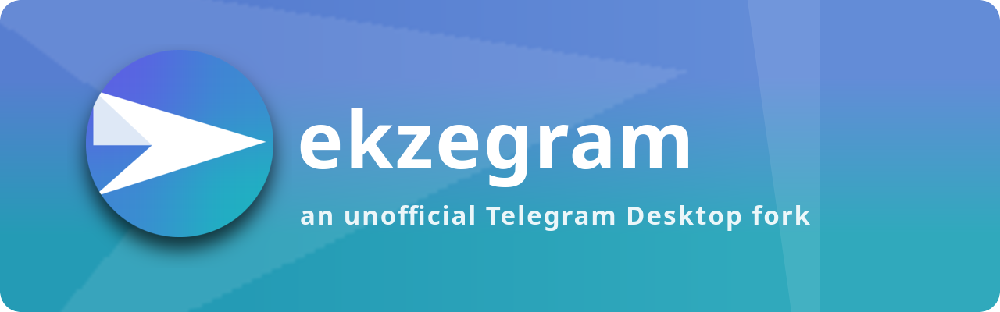

<p align="center">
  
</p>

<p align="center">
  <a href="https://github.com/nyakze/ekzegram/releases"></a>
  
  
  
  <a href="LICENSE"></a>
</p>

<p align="center">
  <a href="#features">Features</a> &nbsp;·&nbsp;
  <a href="#download">Download</a> &nbsp;·&nbsp;
  <a href="#building">Building</a> &nbsp;·&nbsp;
  <a href="#на-русском">Русский</a>
</p>

**ekzegram** is an unofficial fork of [Telegram Desktop][tdesktop] — the same fast
native client with its own name, icons and ready-to-use builds, plus a small set of
convenience features and fixes on top. It follows upstream `dev` closely: everything
else is stock.

## Features

All fork extras are gathered in a dedicated **ekzegram** section of Settings; the rest
of the app looks and behaves like the official client.

* **Widget kill switch** — show a placeholder instead of bot HTML widgets (Mini Apps
  keep working).
* **Link rewriting** — regex rules that rewrite pasted URLs, with an "undo" toast.
* **Open links externally** — open any link through a custom URI scheme, e.g.
  `potplayer://`.
* **Send as copy** — resend messages as new ones, without the "Forwarded from" header.
* **Message menu extras** — save a selection to a Markdown file, copy it depersonalized
  ("Person 1, Person 2…"), group media into an album, share any message, search the
  selected text, remember/replace/swap media.
* **Draft stash** — Ctrl+S stashes the current draft (text, replies, pending files) and
  restores it later.
* **Quality-of-life tweaks** — auto-copy login codes, passcode that submits itself when
  complete, last-seen time in the chat list, "Mute all", "Go to first message",
  emoji-search languages, up to 30 accounts.
* **Safe downgrades** — `tdata` is backed up automatically before an older version
  opens it.

## Download

Prebuilt binaries for **Linux (x86-64)**, **Windows (x64)** and **macOS (Apple Silicon
and Intel)** are on the [Releases][releases] page — a portable zip and an installer for
Windows, DMGs for macOS. The app keeps its profile separate from official Telegram
Desktop, so both can be installed side by side.

## Building

```bash
./build-fork.sh
```

The script sets up submodules and the `tdesktop:centos_env` Docker image on first run
and leaves a Release binary at `out/Release/ekzegram`; see
[docs/building-linux.md](docs/building-linux.md) for details. CI builds all three
platforms on every push — see the [Actions][actions] page.

Building needs your own API credentials ([how to obtain][api_credentials]) — the
well-known public ones cause login errors. Pass them as
`TDESKTOP_API_ID`/`TDESKTOP_API_HASH` repository secrets for CI, or put them in
`~/.config/tdesktop-fork/api.conf` for local builds.

The fork is rebased onto upstream `dev` regularly, with fork-specific changes kept in a
small commit stack so rebases stay cheap.

## Credits

* [Telegram Desktop][tdesktop] — the official client this fork is based on.
* [Forkgram][forkgram] by [23rd][23rd] — several features are adapted from Forkgram and
  remain under the same GPLv3 license. Thanks to the Forkgram maintainers and
  contributors.

## Disclaimer

* Unofficial. Not affiliated with or endorsed by Telegram; the name "Telegram" is used
  only to refer to the original product.
* The application collects no user data — see [PRIVACY.md](PRIVACY.md).
* Builds are **unsigned**: on Windows/macOS you may need to allow the app through
  SmartScreen / Gatekeeper on first launch.
* Distributed under the same terms as upstream: GPLv3 with the OpenSSL exception.

---

## На русском

**ekzegram** — неофициальный форк [Telegram Desktop][tdesktop]: тот же быстрый нативный
клиент со своим названием, иконками и готовыми сборками, плюс небольшой набор удобных
функций и исправлений. Форк следует за апстримом `dev`, всё остальное — как в официальном
клиенте.

### Возможности

Все дополнения собраны в отдельном разделе **ekzegram** в Настройках; в остальном
приложение выглядит и работает как официальный клиент.

* **Отключение HTML-виджетов** в ботах — вместо них показывается заглушка (мини-приложения
  продолжают работать).
* **Переписывание ссылок** — правила с регулярными выражениями меняют вставляемые URL,
  отмена — в один клик.
* **Открытие ссылок внешними программами** — через собственную URI-схему, например
  `potplayer://`.
* **Отправка как копия** — сообщения уходят новыми, без подписи «Переслано от».
* **Пункты меню сообщений** — сохранение выделенного в Markdown-файл, обезличенное
  копирование («Person 1, Person 2…»), сборка медиа в альбом, отправка любого
  сообщения, поиск выделенного текста, работа с медиа («запомнить», «заменить»,
  «поменять местами»).
* **Сохранение черновика** — Ctrl+S откладывает текущий черновик (текст, ответ,
  вложения) и позже восстанавливает его.
* **Удобные мелочи** — автокопирование кодов входа, автоматическая отправка кода
  блокировки, время последнего посещения в списке чатов, «Заглушить все», «К первому
  сообщению», языки поиска эмодзи, до 30 аккаунтов.
* **Безопасный откат** — `tdata` автоматически сохраняется, прежде чем её откроет более
  старая версия.

### Скачать

Готовые бинарники для **Linux (x86-64)**, **Windows (x64)** и **macOS (Apple Silicon и
Intel)** — на странице [Releases][releases]: портативный zip и установщик для Windows,
DMG для macOS. Профиль хранится отдельно от официального Telegram Desktop, так что оба
клиента могут стоять рядом.

### Собрать

```bash
./build-fork.sh
```

Скрипт сам подготовит субмодули и Docker-окружение `tdesktop:centos_env` и соберёт
Release-бинарник в `out/Release/ekzegram`; подробности — в
[docs/building-linux.md](docs/building-linux.md). Для сборки нужны свои API-креды
([как получить][api_credentials]) — секреты `TDESKTOP_API_ID`/`TDESKTOP_API_HASH` для CI
или `~/.config/tdesktop-fork/api.conf` для локальной сборки.

### Благодарности

* [Telegram Desktop][tdesktop] — официальный клиент, на котором основан форк.
* [Forkgram][forkgram] от [23rd][23rd] — часть функций адаптирована из Forkgram и
  распространяется по той же лицензии GPLv3. Спасибо авторам и участникам Forkgram.

### Дисклеймер

* Неофициальный форк. Не аффилирован с Telegram и не одобряется им; название «Telegram»
  используется только для обозначения оригинального продукта.
* Приложение не собирает персональные данные — см. [PRIVACY.md](PRIVACY.md).
* Бинарники **не подписаны**: в Windows/macOS может понадобиться разрешить запуск через
  SmartScreen / Gatekeeper при первом старте.
* Распространяется на тех же условиях, что и апстрим: GPLv3 с исключением OpenSSL.

---

[tdesktop]: https://github.com/telegramdesktop/tdesktop
[forkgram]: https://github.com/forkgram/tdesktop
[23rd]: https://github.com/23rd
[releases]: https://github.com/nyakze/ekzegram/releases
[actions]: https://github.com/nyakze/ekzegram/actions
[api_credentials]: docs/api_credentials.md
